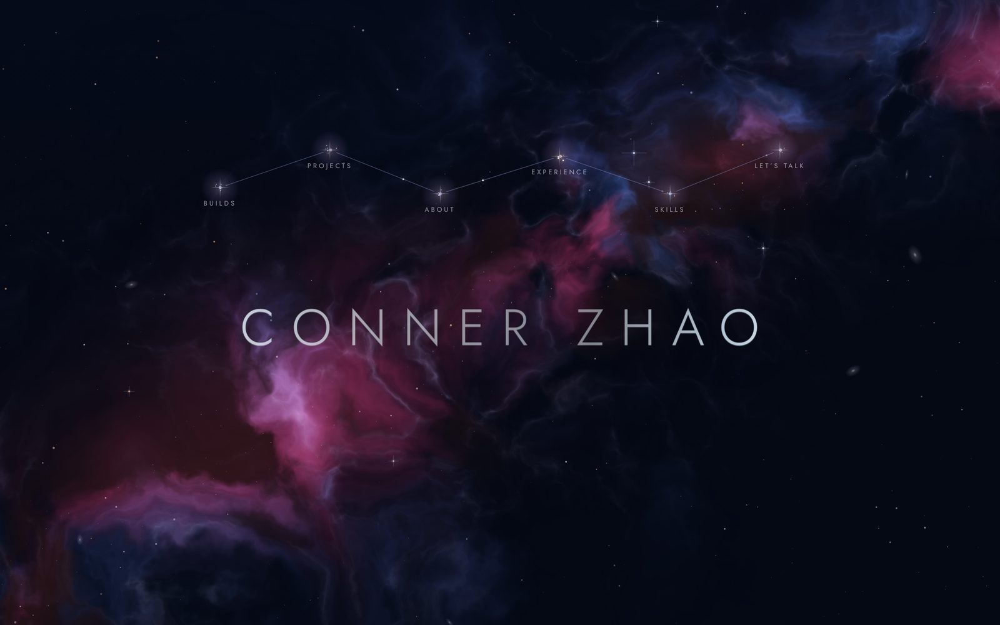
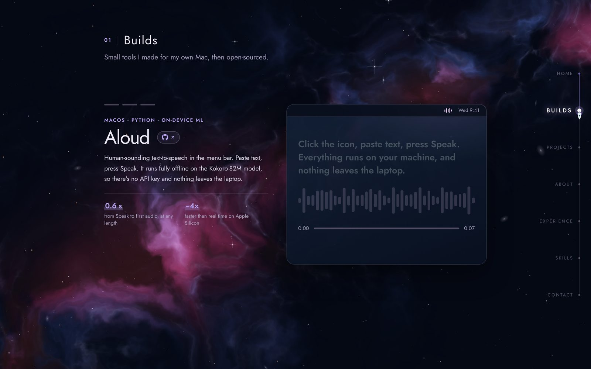
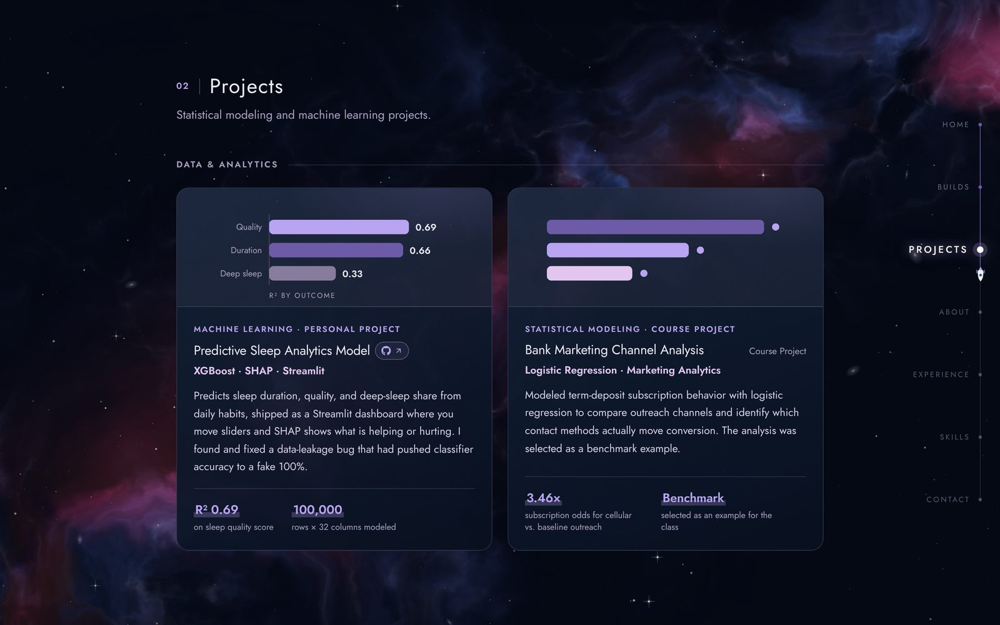
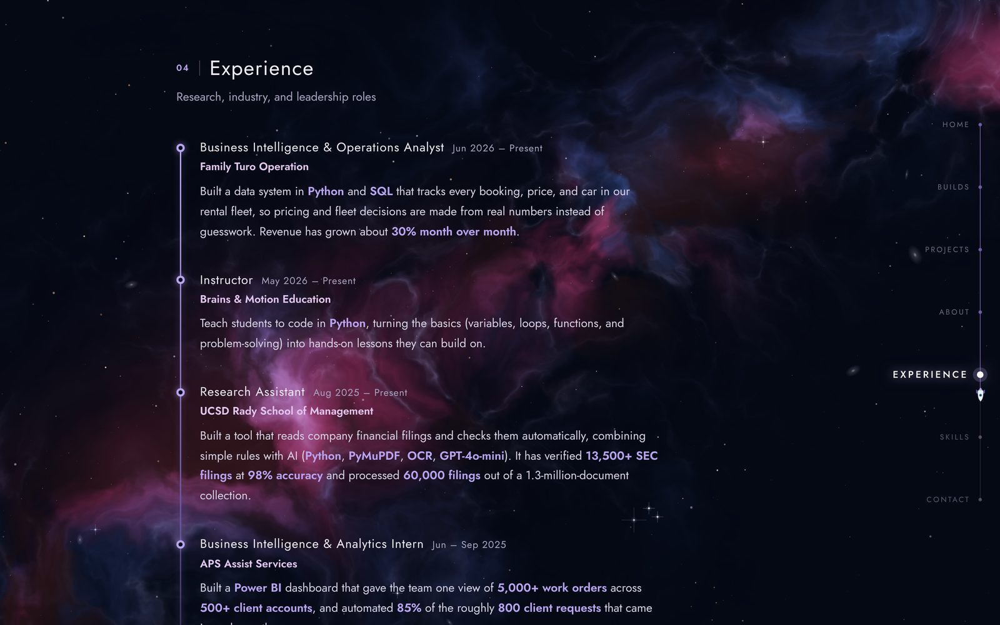

<div align="center">

<a href="https://connerzhao.github.io/personal-portfolio/">
  
</a>

# Conner Zhao · Portfolio

**Data, analytics and small tools, set in a starfield you can fly through.**

[**View the live site →**](https://connerzhao.dev/)

[](https://www.linkedin.com/in/connerzhao/)
[](mailto:ConnerZhao11@gmail.com)
[](https://github.com/ConnerZhao)


</div>

---

## About

This is my personal portfolio. I'm a UC San Diego student at the Rady School of Management (Class of 2027) working toward data, analytics and consulting roles. The site is one hand-built page with no framework, no bundler and no build step. Everything lives in `index.html`, and GitHub Pages serves the repo as is.

## What's on the site

| # | Section | What's there |
|---|---------|--------------|
| 01 | **Builds** | Small Mac tools I made for myself and then open-sourced. Each one gets a scroll-driven demo. |
| 02 | **Projects** | Statistical modeling and machine-learning work, with the key result shown up front. |
| 03 | **About** | School, background, and what I do outside class. |
| 04 | **Experience** | Research, industry and leadership roles on a timeline. |
| 05 | **Skills** | The toolkit behind the work: data and analytics, BI, and building. |
| 06 | **Contact** | Email, socials, and a phone number you click to reveal, over a collage of my photos. |

### Featured work

| Project | What it is | Stack |
|---------|------------|-------|
| [**Aloud**](https://github.com/ConnerZhao/aloud) | Human-sounding text-to-speech in the macOS menu bar. Runs fully offline on Kokoro-82M with about 0.6 s to first audio. | macOS · Python · on-device ML |
| [**Draggy Timer**](https://github.com/ConnerZhao/draggy-timer) | Pull a timer out of the menu bar: the further you drag, the longer it runs. One Swift file, no dependencies. | Swift · AppKit |
| [**Media to JSON**](https://github.com/ConnerZhao/media-to-json) | Turns video or audio files, or a whole folder of them, into timestamped JSON transcripts ready for an LLM. | Python · CLI · faster-whisper |
| [**Predictive Sleep Analytics Model**](https://github.com/ConnerZhao/Predictive-Sleep-Analytics-Model) | Predicts sleep quality, duration and deep-sleep share from daily habits. Ships as a Streamlit app with SHAP explanations. R² 0.69 on 100k rows. | XGBoost · SHAP · Streamlit |
| **Bank Marketing Channel Analysis** | Logistic-regression study of which outreach channels drive term-deposit sign-ups. It was selected as the benchmark example for the class. | Logistic regression · marketing analytics |

## Screenshots

<table>
  <tr>
    <td width="33%"></td>
    <td width="33%"></td>
    <td width="33%"></td>
  </tr>
  <tr>
    <td align="center"><sub><b>Builds</b>: pinned scroll story</sub></td>
    <td align="center"><sub><b>Projects</b>: results up front</sub></td>
    <td align="center"><sub><b>Experience</b>: timeline</sub></td>
  </tr>
</table>

## Under the hood

The site is plain HTML, CSS and JavaScript, but a lot of it moves:

- **Wormhole intro.** A WebGL fragment shader draws the approach as a gravitational lens, so the origin sky bends into an Einstein ring and the destination sky sits squeezed inside the throat. The final frame is the page's own starfield, because the intro and the background share one seeded star catalog. You can skip it.
- **Living starfield.** A Canvas 2D sky with twinkling stars, meteors, a rare supernova, and a small black hole with a tilted Keplerian accretion disk. Your cursor acts as a soft light and links the nearest bright stars like a star chart.
- **Constellation nav.** In the hero, six star clusters around my name each link to a section, and pulses of light travel the lines between them.
- **Builds scroll story.** A pinned stage, similar to Apple's product pages, with three chapters driven by scroll position. The app mockups animate as you scroll: the Aloud waveform plays, the Draggy Timer droplet gets pulled down to 45 minutes, and the JSON output types itself out.
- **Flight-path rail.** A rocket on the right-side rail marks where you are in the page. You can drag the rail like a scrollbar.
- **Liquid Glass pointer.** An adaptive cursor in the style of iPadOS. Spring physics drive its position and shape, and [Motion](https://motion.dev) handles the press and visibility springs.
- **Considerate by default.** It respects `prefers-reduced-motion` throughout and supports forced-colors mode. Section paging uses CSS scroll snap, so the page never hijacks your scrolling. Layouts hold down to 380 px, and phones get their own section nav.

## Tech stack

| Layer | Used |
|-------|------|
| Markup / style / logic | HTML, CSS, vanilla JavaScript, all in `index.html` |
| Graphics | WebGL (GLSL fragment shader) and Canvas 2D |
| Animation | [Motion](https://motion.dev) `11.11.13` via jsDelivr, plus hand-rolled spring physics |
| Type | [Jost](https://fonts.google.com/specimen/Jost) via Google Fonts |
| Images | `<image-slot>` web component (`image-slot.js`) |
| Hosting | GitHub Pages (static, deploys from `main`) |

## Project structure

```
personal-portfolio/
├── index.html          # the whole site: markup, styles, scripts and shaders
├── image-slot.js       # <image-slot> web component used for every photo
├── assets/
│   ├── photos/         # web-compressed photos (headshot + contact collage)
│   └── readme/         # screenshots used in this README
└── README.md
```

## Run it locally

There's nothing to install. Serve the folder and open it:

```bash
git clone https://github.com/ConnerZhao/personal-portfolio.git
cd personal-portfolio
python3 -m http.server 8000
# open http://localhost:8000
```

Opening `index.html` directly also works. A local server is still the better choice, because some browsers block the small `fetch` that `image-slot.js` makes on `file://` pages.

## Updating the site

- **Copy:** edit `index.html`. Each section has an id: `#builds-section`, `#projects`, `#about`, `#experience`, `#skills`, `#contact`.
- **Photos:** replace a file in `assets/photos/` with one of the same name, or change the `src` on its `<image-slot>` tag.
- **Publish:** commit and push to `main`. Pages redeploys in about a minute.

## Deploying to GitHub Pages

1. Go to **Settings → Pages → Build and deployment** and choose **Deploy from a branch**, then `main` / `(root)`, then **Save**.
2. The site goes live at `https://connerzhao.github.io/personal-portfolio/`.

<details>
<summary><b>Custom domain (Porkbun)</b></summary>

<br />

In Porkbun, go to **Domain Management → your domain → DNS**. Delete the default parking ALIAS/CNAME records, then add these records. You can also use Porkbun's one-click **Quick DNS Config → GitHub**, which adds them for you.

| Type  | Host     | Answer                 |
|-------|----------|------------------------|
| A     | *(blank)* | `185.199.108.153`     |
| A     | *(blank)* | `185.199.109.153`     |
| A     | *(blank)* | `185.199.110.153`     |
| A     | *(blank)* | `185.199.111.153`     |
| AAAA  | *(blank)* | `2606:50c0:8000::153` |
| AAAA  | *(blank)* | `2606:50c0:8001::153` |
| AAAA  | *(blank)* | `2606:50c0:8002::153` |
| AAAA  | *(blank)* | `2606:50c0:8003::153` |
| CNAME | `www`    | `connerzhao.github.io` |

Then:

1. In GitHub, go to **Settings → Pages → Custom domain**, enter the domain and click **Save**. This commits a `CNAME` file.
2. Wait for the DNS check to pass, which takes anywhere from minutes to a few hours, then tick **Enforce HTTPS**.
3. Optionally, verify the domain under your profile's **Settings → Pages** to prevent a takeover.

</details>

## Version history

| Version | What changed |
|---------|--------------|
| **V6.1** | One section per screen with CSS scroll snap, a mobile and tablet section nav, and a Builds stage that fits phones and short screens |
| **V6** | Clickable star clusters, one per section, joined into a constellation |
| **V5** | Wormhole exit intro, cinematic type, minimal hero |
| **V4** | Liquid Glass pointer |
| **V3** | Flight-path rail with a draggable scrollbar |

## License

© 2026 Conner Zhao. All rights reserved. You're welcome to read the code and learn from it, but please don't republish the site, its copy or its photos as your own. Each linked project has its own repo and license.

<div align="center">
<br />
<sub>Built in San Diego · UC San Diego Rady School of Management · Class of 2027</sub>
</div>
